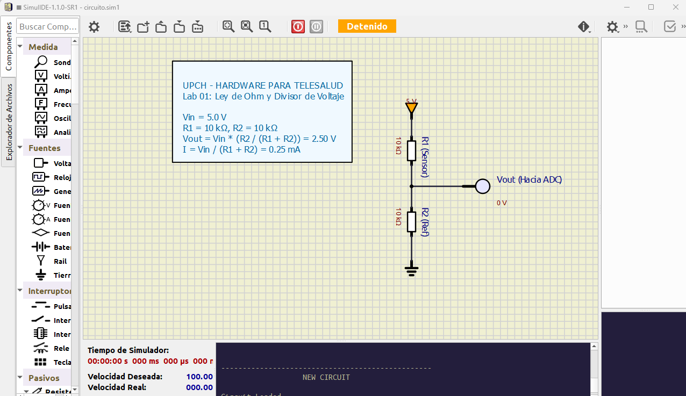

# Laboratorio 01: Ley de Ohm y Divisor de Voltaje

## 1. Introducción y Relevancia en Telesalud
Todo biosensor analógico resistivo —como las galgas extensiométricas de básculas médicas, los termistores NTC de temperatura corporal o las fotorresistencias LDR de pulsioximetría óptica— varía su resistencia eléctrica ante un estímulo físico o fisiológico.

Dado que los microcontroladores (Arduino, ESP32) no miden resistencia directamente sino **voltaje**, el circuito **divisor de tensión** es la primera etapa universal de acondicionamiento de señales en ingeniería biomédica.

En este laboratorio aprenderás a:
- Comprobar experimentalmente la **Ley de Ohm** ($V = I \cdot R$) en SimulIDE.
- Diseñar y calcular un circuito **divisor de voltaje resistivo**.
- Medir caídas de tensión y corrientes utilizando voltímetros, amperímetros y sondas (*Probes*) virtuales.
- Comprender el efecto de carga (*loading effect*) que ocurre al conectar la entrada de un microcontrolador o amplificador.

---

## 2. Fundamento Teórico

### A. Ley de Ohm
La diferencia de potencial ($V$) entre los extremos de un conductor es directamente proporcional a la intensidad de corriente ($I$) que circula por él:
$$V = I \cdot R \quad \iff \quad I = \frac{V}{R} \quad \iff \quad R = \frac{V}{I}$$

### B. Ecuación del Divisor de Voltaje
Al conectar dos resistencias en serie $R_1$ y $R_2$ a una fuente de alimentación $V_{in}$:
$$I = \frac{V_{in}}{R_1 + R_2}$$

La tensión de salida tomada sobre $R_2$ es:
$$V_{out} = I \cdot R_2 = V_{in} \cdot \left( \frac{R_2}{R_1 + R_2} \right)$$
 

#### Ejemplo Numérico:
- $V_{in} = 5.0\text{ V}$
- $R_1 = 10\text{ k}\Omega$
- $R_2 = 10\text{ k}\Omega$
$$V_{out} = 5.0\text{ V} \cdot \frac{10\text{ k}\Omega}{10\text{ k}\Omega + 10\text{ k}\Omega} = 5.0 \cdot 0.5 = 2.50\text{ V}$$

---

## 3. Esquema del Circuito en SimulIDE (`circuito.sim1`)

El archivo contiene:
1. **Fuente de Voltaje DC:** $5\text{ V}$.
2. **Resistencia $R_1$:** $10\text{ k}\Omega$.
3. **Resistencia $R_2$ (o potenciómetro variable):** $10\text{ k}\Omega$.
4. **Sonda de Voltaje (*Probe*):** Ubicada en el nodo intermedio para visualizar $V_{out}$ en pantalla en tiempo real.
5. **Voltímetro Digital:** Conectado en paralelo sobre $R_2$.
6. **Amperímetro en Serie:** Mide la corriente circulante de $0.25\text{ mA}$ ($250\ \mu\text{A}$).

---

## 4. Instrucciones para Simular en SimulIDE

1. Abre el software **SimulIDE** (versión 1.0.0 o 1.1.0).
2. Haz clic en **File > Open** (o pulsa `Ctrl + O`) y selecciona el archivo [`circuito.sim1`](./HARDTES/1_ELECTRONICA_BASICA/01-ley-ohm-divisor-voltaje/circuito.sim1).
3. Presiona el botón **Power Circuit** (icono de botón rojo de encendido en la barra superior).
4. Observa el valor medido por la sonda: debe indicar exactamente `2.5 V`.
5. Haz clic derecho sobre $R_2$, selecciona **Properties** y modifica su resistencia a $20\text{ k}\Omega$:
   $$V_{out} = 5 \cdot \frac{20}{10 + 20} = 3.33\text{ V}$$
   Verifica que la sonda actualiza su lectura inmediatamente a `3.33 V`.

---

## 5. Aplicación Práctica en Telesalud
En un termómetro digital clínico, $R_1$ es reemplazado por un termistor NTC cuyo valor decrece al aumentar la temperatura del paciente. El voltaje $V_{out}$ aumenta de forma proporcional a la temperatura, permitiendo que el convertidor analógico-digital (ADC) del microcontrolador traduzca el voltaje a grados Celsius mediante la ecuación de Steinhart-Hart.
