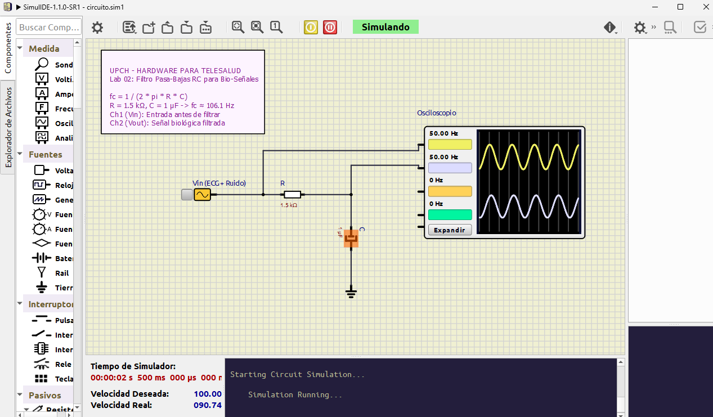

# Laboratorio 02: Filtros Pasivos RC (Pasa-Bajas y Pasa-Altas) para Señales Biomédicas

## 1. Introducción y Relevancia en Telesalud
Las bioseñales humanas tienen anchos de banda muy específicos:
- **Electrocardiografía (ECG):** $0.05\text{ Hz}$ a $150\text{ Hz}$ (amplitud: $0.5\text{ a }5\text{ mV}$).
- **Electromiografía (EMG):** $20\text{ Hz}$ a $500\text{ Hz}$.
- **Electroencefalografía (EEG):** $0.5\text{ Hz}$ a $40\text{ Hz}$ (amplitud: $10\text{ a }100\ \mu\text{V}$).

Durante la adquisición mediante electrodos sobre la piel, se acoplan fuentes masivas de ruido:
1. **Deriva de línea base (Baseline Wander):** Artefacto de muy baja frecuencia ($< 0.5\text{ Hz}$) ocasionado por la respiración del paciente y movimiento de los cables. Requiere un **Filtro Pasa-Altas**.
2. **Ruido electromagnético de alta frecuencia:** Inducido por radiofrecuencia (Wi-Fi, Bluetooth) y fuentes conmutadas ($> 1\text{ kHz}$). Requiere un **Filtro Pasa-Bajas**.

---

## 2. Fundamento Teórico y Matemático

### A. Filtro Pasa-Bajas RC (Low-Pass Filter)
Deja pasar las frecuencias por debajo de la frecuencia de corte ($f_c$) y atenúa las superiores:

### B. Filtro Pasa-Altas RC (High-Pass Filter)
Bloquea la componente continua (DC) y las frecuencias por debajo de $f_c$:

### C. Ecuación de la Frecuencia de Corte ($f_c$)
Es la frecuencia a la cual la potencia cae a la mitad ($-3\text{ dB}$, ganancia $A_v = \frac{1}{\sqrt{2}} \approx 0.707$):
$$f_c = \frac{1}{2 \pi \cdot R \cdot C}$$

#### Dimensionamiento para Filtro Antirruido en Telesalud:
Si seleccionamos $R = 1.5\text{ k}\Omega$ y $C = 1\ \mu\text{F}$:
$$f_c = \frac{1}{2 \cdot \pi \cdot 1500 \cdot 10^{-6}} \approx 106.1\text{ Hz}$$
Atenúa efectivamente ruidos de alta frecuencia mientras preserva el complejo QRS del ECG.

---

## 3. Elementos en SimulIDE (`circuito.sim1`)
1. **Generador de Señales AC / Onda Senoidal:** Configurado a $1\text{ V}$ pico.
2. **Resistor $R$:** $1.5\text{ k}\Omega$.
3. **Condensador $C$:** $1\ \mu\text{F}$.
4. **Osciloscopio Virtual de 2 Canales (`Oscope`):**
   - **Canal 1 (Rojo):** Señal de entrada $V_{in}$.
   - **Canal 2 (Azul):** Señal filtrada de salida $V_{out}$.
5. **Sonda (*Probe*):** Para monitoreo de amplitud y fase.

---

## 4. Procedimiento de Simulación en SimulIDE

1. Abre SimulIDE y carga [`circuito.sim1`](./HARDTES/1_ELECTRONICA_BASICA/02-filtro-rc-pasabajas-pasoaltos/circuito.sim1).
2. Enciende el circuito (**Power Circuit**).
3. Abre la ventana del **Osciloscopio**:
   - Con una frecuencia de entrada baja ($10\text{ Hz}$), observa cómo la señal de salida $V_{out}$ pasa casi intacta (amplitud cercana a $1\text{ V}$).
   - Cambia la frecuencia del generador a la frecuencia de corte ($106\text{ Hz}$): observa que la salida cae a $0.707\text{ V}$ con un desfasaje de $45^\circ$.
   - Aumenta la frecuencia a $1000\text{ Hz}$ ($1\text{ kHz}$): observa cómo la amplitud de salida se reduce drásticamente a menos de $0.1\text{ V}$ (atenuación severa del ruido).
