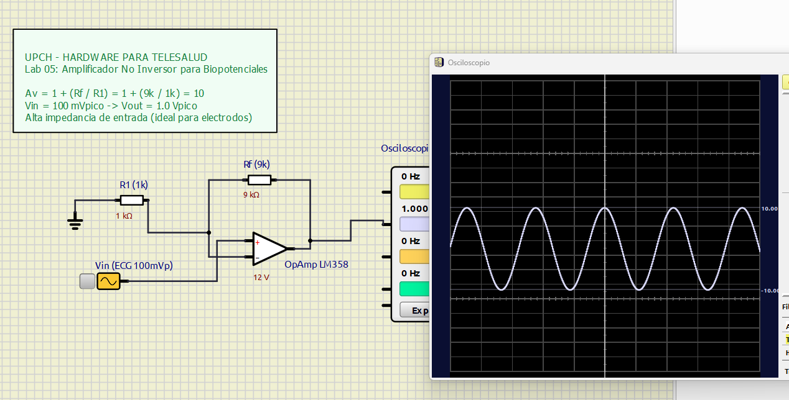

# Laboratorio 05: Amplificadores Operacionales para Front-End Biomédico

## 1. Introducción y Relevancia en Telesalud
Las señales bioeléctricas humanas son extremadamente débiles:
- **ECG:** $1\text{ mV}$ pico a pico.
- **EEG:** $10\ \mu\text{V}$ a $100\ \mu\text{V}$.
Además, la interfaz entre la piel del paciente y los electrodos (Ag/AgCl) presenta una impedancia de contacto de varios kiloohmios. Si conectáramos los electrodos directamente al ADC del microcontrolador, la baja impedancia del conversor atenuaría o destruiría la señal por efecto de carga (*loading effect*).

El **Amplificador Operacional (OpAmp)** es el componente activo fundamental en ingeniería clínica:
- Proporciona una **impedancia de entrada casi infinita** ($> 10^{12}\ \Omega$).
- Amplifica bioseñales de milivoltios al rango de voltios utilizable por el ADC ($0\text{ a }3.3\text{ V}$ o $0\text{ a }5\text{ V}$).

---

## 2. Fundamento Teórico

### A. Reglas de Oro del OpAmp Ideal (con realimentación negativa):
1. **$I_+ = I_- = 0$:** Las corrientes que entran a los terminales inversor y no inversor son exactamente cero.
2. **Cortocircuito Virtual ($V_+ = V_-$):** La realimentación negativa obliga a que la diferencia de potencial entre las dos entradas sea nula.

---

### B. Configuraciones Esenciales

#### 1. Seguidor de Voltaje (Buffer de Alta Impedancia)
- **Ganancia:** $A_v = 1$ ($V_{out} = V_{in}$).
- **Propósito Clínico:** Aislar electrodos cutáneos de alta impedancia sin atenuar la señal biológica.

#### 2. Amplificador No Inversor
- **Ecuación:**
  $$V_{out} = V_{in} \cdot \left( 1 + \frac{R_f}{R_1} \right)$$
- **Ventaja Biomédica:** Mantiene la polaridad de las ondas P-Q-R-S-T del electrocardiograma y preserva la altísima impedancia de entrada en el pin no inversor ($V_+$).

#### Ejemplo de Cálculo de Ganancia:
Para elevar una señal ECG de $10\text{ mV}$ a $1.0\text{ V}$ (factor $\times 100$):
$$A_v = 1 + \frac{R_f}{R_1} = 100 \implies \frac{R_f}{R_1} = 99$$
Seleccionando $R_1 = 1\text{ k}\Omega \implies R_f = 100\text{ k}\Omega \implies A_v \approx 101$.

---

## 3. Elementos en SimulIDE (`circuito.sim1`)
1. **OpAmp:** Modelo con rieles $\pm 12\text{ V}$ (o $5\text{ V} / 0\text{ V}$).
2. **Fuente de Entrada:** Señal senoidal pequeña de $50\text{ mV}$ simulando un biopotencial.
3. **Resistencias de Realimentación:** $R_1 = 1\text{ k}\Omega$, $R_f = 9\text{ k}\Omega$ (Ganancia $A_v = 10$).
4. **Osciloscopio Virtual de 2 Canales:**
   - **Canal 1:** $V_{in}$ ($50\text{ mV}$).
   - **Canal 2:** $V_{out}$ amplificada ($500\text{ mV}$).

---

## 4. Procedimiento de Simulación en SimulIDE

1. Carga [`circuito.sim1`](file:///d:/DOCUMENTOS/PROJECTS/HARDTES/1_ELECTRONICA_BASICA/05-amplificador-operacional-bio/circuito.sim1) en SimulIDE.
2. Presiona **Power Circuit**.
3. Abre el **Osciloscopio**:
   - Observa la señal de entrada en el Canal 1 y cómo el Canal 2 entrega exactamente una señal 10 veces mayor en fase perfecta.
   - Experimenta aumentando la amplitud de entrada a $2\text{ V}$: observa cómo el OpAmp se satura al alcanzar el límite de sus rieles de alimentación, ilustrando el fenómeno clínico de saturación por artefacto de movimiento.
