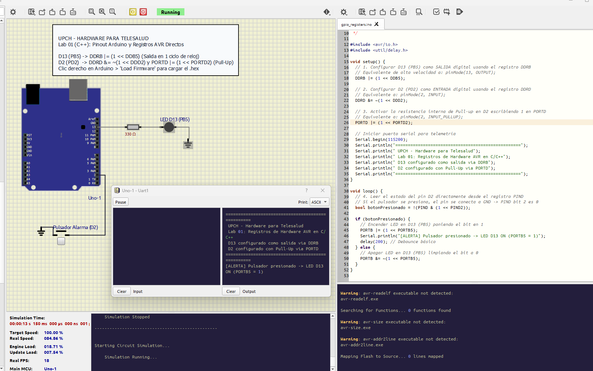

# Laboratorio 01: Pinout del Arduino Uno y Manipulación de GPIOs con Registros AVR

## 1. Introducción y Relevancia en Telesalud
En el desarrollo de instrumentación biomédica de alta velocidad (como la adquisición de pulsos cardíacos o el disparo sincronizado de estimuladores), la función estándar `digitalWrite()` de Arduino tarda aproximadamente **50 a 60 ciclos de reloj** ($\approx 3.5\ \mu\text{s}$) debido a la verificación de pines y tablas de mapeo en memoria Flash.

La manipulación directa de los **Registros de Entrada/Salida (I/O) del microcontrolador ATmega328P** se ejecuta en tan solo **1 ciclo de reloj** ($62.5\text{ ns}$ a $16\text{ MHz}$), es decir, ¡más de 50 veces más rápido!

En este laboratorio aprenderás a:
- Comprender la arquitectura y el pinout de puertos del microcontrolador ATmega328P (**PORTB, PORTC, PORTD**).
- Dominar los operadores a nivel de bits en C/C++: `&` (AND), `|` (OR), `^` (XOR), `~` (NOT), `<<` (desplazamiento a la izquierda).
- Controlar entradas y salidas digitales manipulando directamente los registros `DDRx`, `PORTx` y `PINx`.
- Simular el microcontrolador Arduino Uno ejecutando el firmware en **SimulIDE**.



---

## 2. Mapa de Registros del ATmega328P

El microcontrolador organiza sus 28 pines físicos en 3 puertos de 8 bits:


### Los 3 Registros Fundamentales por Puerto:
1. **`DDRx` (Data Direction Register):** Configura la dirección del pin:
   - Bit en `1` = Pin en modo **SALIDA** (`OUTPUT`).
   - Bit en `0` = Pin en modo **ENTRADA** (`INPUT`).
2. **`PORTx` (Data Register):**
   - En salidas: Escribe nivel `HIGH` (`1`) o `LOW` (`0`).
   - En entradas: Habilita (`1`) o deshabilita (`0`) la resistencia interna de Pull-up.
3. **`PINx` (Input Pins Address):** Lee el estado lógico presente en el pin físico.

---

## 3. Operaciones a Nivel de Bits en C/C++ Embebido

```c
// Configurar el Pin 13 (PB5) como SALIDA sin alterar los demás pines:
DDRB |= (1 << PB5);     // 1 << 5 equivale a 0b00100000

// Poner el Pin 13 en ALTO (HIGH):
PORTB |= (1 << PB5);    // Establece el bit 5 en 1

// Poner el Pin 13 en BAJO (LOW):
PORTB &= ~(1 << PB5);   // Limpia el bit 5 dejándolo en 0

// Invertir el estado (Toggle):
PORTB ^= (1 << PB5);    // Conmuta con operación XOR

// Leer el estado del Pin 2 (PD2 / D2):
if (PIND & (1 << PD2)) {
    // El pin está en HIGH
}
```

---

## 4. Código Fuente del Firmware (`firmware/gpio_registers.ino`)

El firmware configura el LED de estado (PB5 / D13) como salida y un pulsador de alarma (PD2 / D2) como entrada con pull-up interno, alternando el LED a ultra-alta velocidad mediante operaciones de registro puro en C/C++.

---

## 5. Simulación en SimulIDE (`circuito.sim1`)

1. Carga [`circuito.sim1`](file:///d:/DOCUMENTOS/PROJECTS/HARDTES/2_ARDUINO_UNO_C%2B%2B/01-pinout-gpio-registros-avr/circuito.sim1) en SimulIDE.
2. Haz clic derecho sobre el componente **Arduino Uno** y selecciona **Load Firmware**.
3. Selecciona el archivo compilado `.hex` (generado por Arduino IDE con `Ctrl + Alt + S` o ubicado en la carpeta del proyecto).
4. Presiona **Power Circuit** en SimulIDE y presiona el pulsador conectado al pin D2 para verificar la conmutación inmediata del LED en el pin D13.
