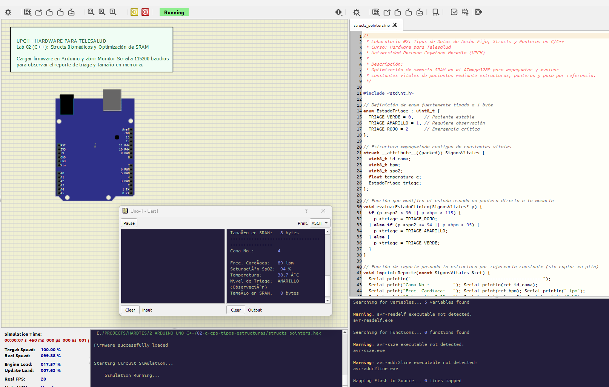

# Laboratorio 02: Sintaxis C/C++ Embebido: Tipos de Datos, Structs y Punteros

## 1. Introducción y Relevancia en Telesalud
El microcontrolador ATmega328P dispone de únicamente **2048 bytes (2 KB) de memoria SRAM**. En un firmware de telemedicina donde se manejan datos de múltiples pacientes, buffers de comunicación y variables de sensores, un mal uso de tipos de datos o el paso de parámetros por copia puede provocar el agotamiento de la pila (*Stack Overflow*) y reiniciar el equipo en pleno monitoreo clínico.

En este laboratorio aprenderás a:
- Utilizar tipos de datos estándar con longitud explícita en bits (`<stdint.h>`).
- Empaquetar constantes vitales en estructuras contiguas de memoria (`struct`).
- Utilizar enumeraciones fuertemente tipadas (`enum`) para estados clínicos de triage.
- Emplear **punteros y referencias en C++** para procesar telemetría sin duplicar memoria.



---

## 2. Tipos de Datos Enteros de Ancho Fijo (`<stdint.h>`)

| Tipo en C/C++ | Rango de Valores | Tamaño en RAM | Uso Típico en Telesalud |
| :--- | :--- | :--- | :--- |
| `uint8_t` | $0\text{ a }255$ | 1 byte | Frecuencia cardíaca (BPM), SpO2 ($0-100\%$), porcentaje de batería. |
| `int8_t` | $-128\text{ a }+127$ | 1 byte | Calibración de temperatura, offset de señal. |
| `uint16_t` | $0\text{ a }65535$ | 2 bytes | Lectura cruda del ADC de 10 bits ($0-1023$), milivoltios. |
| `int16_t` | $-32768\text{ a }+32767$ | 2 bytes | Muestra de ECG con signo y filtro digital. |
| `uint32_t` | $0\text{ a }4\cdot 10^9$ | 4 bytes | Timestamps `millis()`, conteo de muestras. |
| `float` | Precisión simple IEEE 754 | 4 bytes | Temperatura corporal en °C ($36.5^\circ\text{C}$). |

---

## 3. Estructura Biomédica y Paso por Referencia en C++

```cpp
// Estado de triage médico
enum EstadoTriage : uint8_t {
    ESTABLE = 0,
    OBSERVACION = 1,
    CRITICO = 2
};

// Estructura empaquetada de telemetría de paciente
struct SignosVitales {
    uint8_t id_paciente;
    uint8_t bpm;
    uint8_t spo2;
    float temperatura_c;
    EstadoTriage triage;
};

// Función optimizada: Paso por referencia constante (cero consumo extra de SRAM)
void evaluarPaciente(const SignosVitales &paciente) {
    if (paciente.spo2 < 90 || paciente.bpm > 110) {
        // Alerta médica
    }
}
```

---

## 4. Código Fuente del Firmware (`firmware/structs_pointers.ino`)

Demuestra la creación de instancias en memoria estática, manipulación mediante punteros y emisión de diagnósticos por el puerto serie.

---

## 5. Simulación en SimulIDE (`circuito.sim1`)
El circuito incluye un Arduino Uno y un monitor serial virtual para observar la impresión estructurada de constantes vitales evaluadas por el algoritmo en C++.
