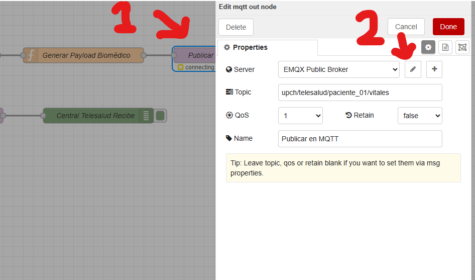
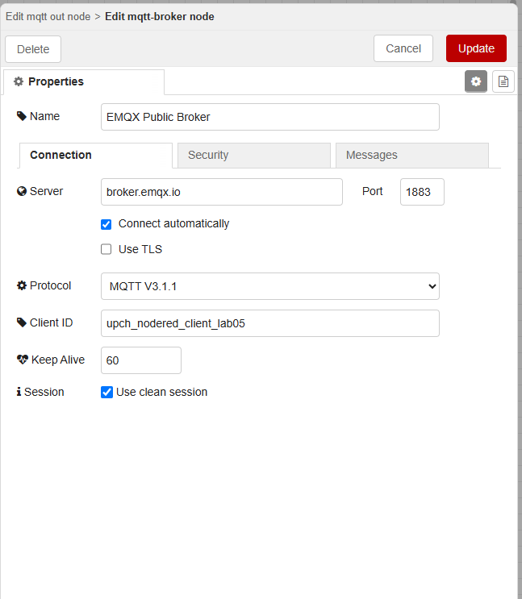

# Laboratorio 05: Comunicación MQTT (Pub/Sub) para Telemetría Biomédica

## 1. Introducción y Objetivos
El protocolo **MQTT** es el pilar de conectividad del Internet of Medical Things (IoMT) gracias a su arquitectura ultraligera basada en eventos.

En este laboratorio aprenderás a:
- Conectar Node-RED a un Broker MQTT (usando el broker público de pruebas `broker.emqx.io` o un broker Mosquitto local).
- Emplear el nodo **MQTT Out** para publicar telemetría de biosensores y comandos de telecontrol.
- Utilizar el nodo **MQTT In** para suscribirte a tópicos con comodines (`+` y `#`).
- Comprender la configuración de **QoS (0, 1, 2)** y el flag **Retain** en sistemas hospitalarios.

---

## 2. Nodos MQTT en Node-RED

| Nodo | Modo | Función |
| :--- | :--- | :--- |
| **MQTT In** | Suscriptor | Escucha un tópico o patrón de tópicos. Cada vez que cualquier cliente publica en ese canal, el nodo genera un `msg` con `msg.payload` y `msg.topic`. |
| **MQTT Out** | Publicador | Envía el contenido de `msg.payload` hacia el broker en el tópico definido en el nodo o en `msg.topic`. |

---

## 3. Taxonomía de Tópicos en Telesalud

Un diseño ordenado de tópicos permite escalar desde un solo paciente hasta miles en un hospital:
```
upch/telesalud/<ID_PACIENTE>/<TIPO_DATOS>
```
Ejemplos prácticos:
- `upch/telesalud/paciente_01/vitales` (BPM, SpO2, Temperatura corporal).
- `upch/telesalud/paciente_01/alarmas` (Caídas, botón de pánico, arritmias).
- `upch/telesalud/paciente_01/comandos` (Cambiar tasa de muestreo, resetear sensor).

### Comodines (Wildcards) de Suscripción:
- `upch/telesalud/+/vitales` -> Escucha los signos vitales de **todos** los pacientes de la UPCH.
- `upch/telesalud/#` -> Escucha absolutamente todo lo que ocurra bajo la raíz `upch/telesalud/`.

---

## 4. Arquitectura del Flujo






---

## 5. Parámetros del Broker MQTT Utilizado en el Laboratorio
- **Broker Host:** `broker.emqx.io`
- **Puerto:** `1883` (TCP estándar no cifrado para laboratorio didáctico)
- **Client ID:** Generado automáticamente con prefijo `upch_nodered_` para evitar colisiones.
- **QoS:** `1` (At least once — recomendado para telemetría médica periódica).


Otros Brokers:

| Broker / Proveedor | Host (Dirección) | Puerto MQTT (Sin cifrar) | Puerto MQTT (Seguro/TLS) | Puerto WebSockets | Uso Ideal y Recomendaciones |
| :--- | :--- | :--- | :--- | :--- | :--- |
| **HiveMQ** | `broker.hivemq.com` | `1883` | `8883` | `8000` | Pruebas generales y experimentación rápida por su alta disponibilidad. |
| **Eclipse Mosquitto** | `test.mosquitto.org` | `1883` | `8883` | `8080` | Servidor de prueba oficial de código abierto para validar clientes y scripts. |
| **EMQX** | `broker.emqx.io` | `1883` | `8883` | `8083` | Excelente rendimiento; cuenta con panel web público para pruebas directas. |
| **Eclipse IoT** | `mqtt.eclipseprojects.io` | `1883` | `8883` | *No especificado* | Punto de acceso alternativo provisto por la fundación Eclipse para desarrolladores IoT. |

⚠️ Advertencia importante: Los brokers públicos son totalmente abiertos y compartidos con cualquier persona en el mundo. Nunca envíes contraseñas, datos sensibles, información médica de pacientes o credenciales privadas a través de estos servidores, ya que cualquier usuario conectado puede suscribirse a los canales (topics) y ver la información en tiempo real. Utilízalos estrictamente para datos de prueba o simulación.


---

## 6. Cómo Importar y Ejecutar
1. Copia el archivo [`flow.json`](./HARDTES/4_NODE-RED/05-mqtt-communication/flow.json).
2. En Node-RED: `☰` > **Import** > Pegar > **Import** > **Deploy**.
3. Verifica que ambos nodos MQTT muestren un indicador verde con la palabra **connected**.
4. Haz clic en el botón de inyección del nodo **Publicar Signos Vitales**:
   - El mensaje saldrá hacia el broker en la nube de EMQX y regresará inmediatamente por el nodo de suscripción.
   - Observa en el panel de Debug cómo el mensaje recibido contiene el tópico de procedencia y los datos de salud del paciente.
