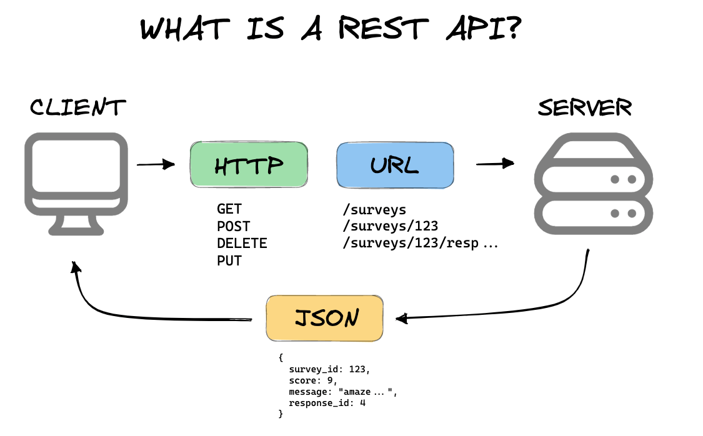
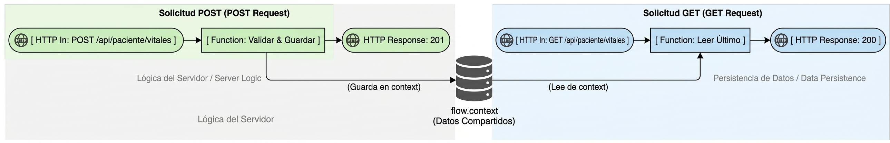

# Laboratorio 06: Creación y Consumo de APIs REST (HTTP)

## 1. Introducción y Objetivos
Las APIs REST son el estándar de interoperabilidad web para comunicar sistemas clientes y servidores, como: dispositivos médicos con plataformas de gestión clínica, historias clínicas electrónicas (EHR) y servicios en la nube.



En este laboratorio aprenderás a:
- Transformar Node-RED en un **Servidor de API REST** capaz de exponer endpoints HTTP accesibles desde cualquier red o dispositivo (como un ESP32).
- Utilizar el nodo **HTTP In** para definir métodos (`GET`, `POST`) y rutas URL (`/api/paciente/vitales`).
- Emplear el nodo **HTTP Response** para responder con códigos de estado estandarizados (`200 OK`, `201 Created`, `400 Bad Request`) y encabezados `Content-Type: application/json`.
- Almacenar la última lectura en el contexto de flujo (`flow.context`) para permitir consultas persistentes.
- Usar el nodo **HTTP Request** para consumir servicios REST externos.

---

## 2. Nodos HTTP en Node-RED

| Nodo | Función |
| :--- | :--- |
| **HTTP In** | Abre un endpoint HTTP en el servidor de Node-RED (por defecto puerto 1880). Cuando llega una petición, entrega los parámetros de consulta en `msg.req.query` y el cuerpo JSON en `msg.payload`. |
| **HTTP Response** | Cierra la transacción HTTP devolviendo `msg.payload` al cliente con el código `msg.statusCode`. |
| **HTTP Request** | Actúa como cliente HTTP para consultar o publicar datos en servidores y APIs de terceros. |

---

## 3. Especificación de la API Creada en el Flujo

### 1. `POST /api/paciente/vitales`
- **Propósito:** Recibir lecturas enviadas por el monitor ESP32.
- **Cuerpo (JSON):**
  ```json
  {
    "paciente_id": "PAC-101",
    "bpm": 74,
    "spo2": 98,
    "temp": 36.6
  }
  ```
- **Respuesta Exitosa:** `201 Created`
  ```json
  {
    "status": "success",
    "mensaje": "Signos vitales registrados correctamente",
    "registrado_en": "2026-10-20T17:20:00Z"
  }
  ```

### 2. `GET /api/paciente/vitales`
- **Propósito:** Permitir a cualquier navegador o app móvil consultar el último estado del paciente.
- **Respuesta:** `200 OK` con el último registro guardado.

---

## 4. Arquitectura del Flujo



---

## 5. Cómo Probar la API Localmente

Una vez desplegado el flujo en Node-RED, puedes probar los endpoints desde tu terminal usando `curl` o mediante Postman:

### Probar POST (Registro):
```bash
$ curl -X POST http://localhost:1880/api/paciente/vitales \
  -H "Content-Type: application/json" \
  -d "{\"paciente_id\":\"PAC-101\",\"bpm\":78,\"spo2\":99,\"temp\":36.5}"
```

```bash
$ curl -X POST http://localhost:1880/api/paciente/vitales -H "Content-Type: application/json" -d "{\"paciente_id\":\"PAC-101\",\"bpm\":78,\"spo2\":99,\"temp\":36.5}"
```

### Probar GET (Consulta):
```bash
$ curl -X GET http://localhost:1880/api/paciente/vitales
```
O simplemente abriendo en tu navegador la URL:
`http://localhost:1880/api/paciente/vitales`

### En Postman


---

## 6. Cómo Importar el Flujo
1. Copia el archivo [`flow.json`](./HARDTES/4_NODE-RED/06-http-rest-api/flow.json).
2. En Node-RED: `☰` > **Import** > Pegar > **Import** > **Deploy**.
3. Realiza las pruebas con cURL, navegador o los nodos de inyección de prueba incluidos en el flujo.
