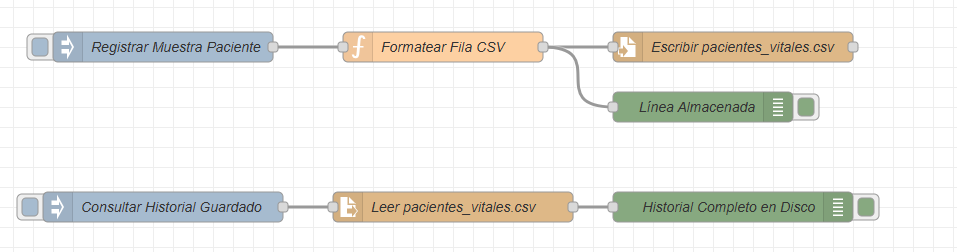

# Laboratorio 07: Almacenamiento, Archivos y Persistencia de Telemetría

## 1. Introducción y Objetivos
En cualquier sistema de telesalud o monitorización continua, los datos no pueden residir únicamente en la memoria volátil (RAM). Es indispensable garantizar la **persistencia** para auditoría clínica, generación de historiales médicos y cumplimiento normativo (trazabilidad de eventos adversos).

En este laboratorio aprenderás a:
- Utilizar el nodo **File** para registrar mediciones en modo *append* (anexar al final de la línea) en formato CSV o JSONL.
- Utilizar el nodo **File In** para leer registros históricos bajo demanda y devolverlos a un cliente o dashboard.
- Diseñar esquemas de almacenamiento para series temporales biomédicas.
- Conocer la arquitectura de bases de datos relacionales (SQLite, PostgreSQL) y de series temporales (InfluxDB) en pasarelas médicas (*Edge Gateways*).

---

## 2. Nodos de Almacenamiento en Node-RED

| Nodo | Modo | Función |
| :--- | :--- | :--- |
| **File** | Escritura (`append` / `overwrite`) | Guarda el contenido de `msg.payload` en una ruta del sistema de archivos local (`pacientes_vitales.csv`). Agrega saltos de línea automáticos. |
| **File In** | Lectura (`utf8` / `buffer`) | Lee un archivo desde disco al recibir un mensaje desencadenante y entrega su contenido en `msg.payload`. |

---

## 3. Esquema del Registro de Auditoría (CSV)

Cada muestra recibida por los biosensores se formatea antes de escribir al disco con la siguiente estructura:
```csv
timestamp,paciente_id,bpm,spo2,temperatura_c,estado
2026-10-20T17:30:15.120Z,PAC-101,74,98,36.6,ESTABLE
2026-10-20T17:30:20.145Z,PAC-101,118,88,38.2,CRITICO
```

---

## 4. Arquitectura del Flujo




---

## 5. Estrategia de Persistencia Profesional en Telesalud

1. **Edge Logging (Almacenamiento Local):**
   - En una Raspberry Pi o pasarela local en el hospital, si se pierde la conexión a Internet, los datos se guardan en un archivo rotativo local o base de datos SQLite embebida.
2. **Sincronización Diferida (Store & Forward):**
   - Cuando se restablece la conectividad hacia la nube, un flujo de Node-RED lee el archivo local no transmitido y lo envía al servidor central mediante MQTT con QoS 1 o peticiones HTTP en lotes (*batch*).
3. **Bases de Datos para Telemetría:**
   - **SQLite:** Cero configuración, liviana, ideal para guardar perfiles de pacientes y configuraciones locales.
   - **InfluxDB:** Optimizada específicamente para series temporales de alta frecuencia (como ondas ECG de 250 Hz).

---

## 6. Cómo Importar y Ejecutar
1. Copia el archivo [`flow.json`](./HARDTES/4_NODE-RED/07-storage-and-databases/flow.json).
2. En Node-RED: `☰` > **Import** > Pegar > **Import** > **Deploy**.
3. Haz clic repetidamente en **Registrar Muestra Paciente**:
   - Cada clic genera un registro con fecha, hora y datos vitales agregándose al archivo `pacientes_vitales.csv` en el directorio de trabajo de Node-RED.
4. Haz clic en **Consultar Historial Guardado**:
   - El nodo *File In* leerá el archivo completo y lo mostrará en el panel de Debug.
